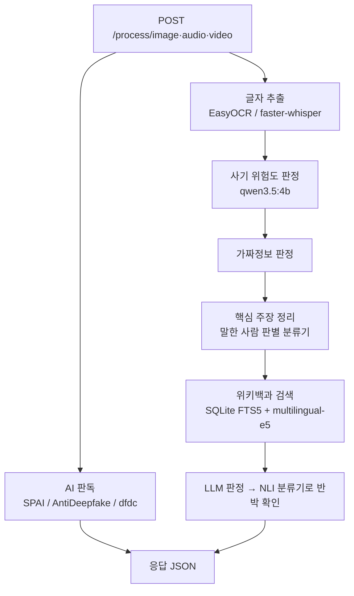

# veritae-detection-server

AI 기반 디지털 사기 예방·콘텐츠 신뢰도 분석 플랫폼 **Veritae**의 GPU 탐지 서버입니다.
이미지·음성·영상 파일을 받아 AI 생성·조작 여부, 사기 위험도, 가짜정보를 판정합니다.

API 서버 [veritae-server](https://github.com/sungbeenCho/Veritae-server)(Spring Boot)가 이 서버를 호출하고,
회원·기록 관리와 앱 응답은 그쪽이 맡습니다. 이 서버는 모델 추론만 합니다.

## 하는 일

| 판정 | 입력 | 모델 | 근거로 돌려주는 것 |
|---|---|---|---|
| AI 생성 이미지 | 이미지 | [SPAI](https://github.com/mever-team/spai) | attention 히트맵 |
| AI 합성 음성 | 음성 | [AntiDeepfake](https://github.com/nii-yamagishilab/AntiDeepfake) | 의심 시간 구간 |
| 얼굴 딥페이크 | 영상 | [selimsef/dfdc](https://github.com/selimsef/dfdc_deepfake_challenge) (DFDC 1위, 7개 앙상블) | Grad-CAM 히트맵 |
| 사기 위험도 | 화면 글자, 말소리 | qwen3.5:4b (Ollama) | 판단 이유 문장 |
| 가짜정보 | 화면 글자, 말소리 | qwen3.5:4b + 한국어 위키백과 검색 + NLI 분류기 | 반박 근거 문장과 위키백과 링크 |

글자는 EasyOCR(이미지·영상 화면), 말소리는 faster-whisper large-v3로 뽑습니다.
유료 LLM API 없이 모든 모델을 데스크탑(RTX 3060 Ti 8GB)에서 로컬로 실행합니다. AntiDeepfake와 EasyOCR은 CPU, 나머지는 GPU를 씁니다.

## 처리 흐름



- **모델 격리**: 모델마다 의존성이 충돌해 conda 환경을 나누고, 서버는 각 모델을 별도 프로세스로 실행해 결과만 받습니다.
- **GPU 대기열**: 8GB GPU 하나를 여러 모델이 나눠 쓰므로, GPU 작업은 대기열로 순서대로 처리하고 대기열이 가득 차면 503을 돌려줍니다.
- **LLM 한 번만 올리기**: 사기 판정과 가짜정보 판정은 같은 LLM으로 이어서 처리하고, 끝나면 GPU에서 내립니다.
- **가짜정보 판정**: LLM 혼자 판정하지 않습니다. 문장의 핵심 주장을 정리하고, 직접 학습한 말한 사람 판별 분류기로 "~가 아니다"처럼 부정하는 문장을 가려 판정 방식을 나눕니다. 위키백과에서 찾은 근거 문단 안에서만 판단하게 한 뒤, 직접 학습한 NLI 분류기가 근거가 실제로 반박하는지 한 번 더 확인합니다. 확신이 없으면 표시하지 않습니다.

## 측정 결과

사기 위험도 판정(최종 지시문, 점수 0.5 이상을 사기로 볼 때):

| 시험 세트 | 탐지율 | 정상 오탐률 |
|---|---|---|
| 실제 문자 (정상 200 / 사기 200) | 80% | 2% |
| 실제 통화 (KorCCVi 142) | 80% | 3% |

처음 쓰던 공개 분류 모델(`Lilju/voicephishing_kobert`)이 정상 문장까지 사기로 판정하는 것을 측정으로 확인했습니다.
공개 한국어 스미싱 모델 5개도 시험했지만 기준에 못 미쳐, 로컬 LLM 판정으로 바꿨습니다.
알려진 약점(문자 속 지시로 판정을 속이는 공격 등)과 보완 계획은
[veritae-server 약점 문서](https://github.com/sungbeenCho/Veritae-server/blob/main/docs/superpowers/specs/2026-10-27-scam-llm-weaknesses.md)에 정리돼 있습니다.

가짜정보 판정은 맞는 문장을 거짓으로 표시하는 "위험 오답"을 가장 줄이는 쪽으로 설계를 골랐습니다. 지금 방식은 이전 방식보다
측정 문장 295개에서 위험 오답을 25건에서 9건으로 줄였고, 설계·학습에 쓰지 않은 새 문장 70개에서는 0건이었습니다.
회귀 시험 세트와 실행 방법은 [`tests/regression`](tests/regression/README.md)에 있습니다.

## API

| Method | 경로 | 설명 |
|---|---|---|
| GET | `/health` | 상태 확인(접근 키 없이 허용) |
| POST | `/process/image` | 이미지 분석 |
| POST | `/process/audio` | 음성 분석 |
| POST | `/process/video` | 영상 분석 |

`DETECTION_API_KEY`가 설정돼 있으면 `/health`를 뺀 모든 요청에 같은 값의 `X-Detection-Key` 헤더가 있어야 합니다.

## 운영 구성

- RTX 3060 Ti 데스크탑(Windows)에서 실행하고, 분석이 필요할 때만 켭니다.
- AWS EC2의 Spring 서버와는 Tailscale 사설망으로만 연결되며, 인터넷에 포트를 열지 않습니다.
- 공유 비밀 키(`X-Detection-Key`)로 Spring 서버의 요청만 받습니다.

## 설치와 실행

데스크탑에 처음부터 설치하는 전체 절차(conda 환경, 모델 가중치, Ollama, 위키 색인 구축, 환경변수)는
[`docs/SETUP.md`](docs/SETUP.md)에 있습니다. 설치가 끝난 뒤 실행은 다음과 같습니다.

```powershell
conda activate detection-api
cd C:\ai\veritae-detection-server
uvicorn app.main:app --host 0.0.0.0 --port 8000
```

## 구성

```
app/
├── main.py           # FastAPI 앱, 접근 키 검사
├── config.py         # 환경변수 설정
├── routers/          # /process/image·audio·video
└── services/         # 모델별 실행기, GPU 대기열, 사기·가짜정보 판정
scripts/              # 모델별 추론 스크립트, 위키 색인 구축, NLI 학습, 측정 도구
tests/                # 단위 테스트, 가짜정보 회귀 세트, 사기 판정 시험 세트
docs/SETUP.md         # 데스크탑 설치·실행 안내
```

## 테스트

```bash
pip install -r requirements-dev.txt
python -m pytest tests -q
```

모델 없이 도는 단위 테스트 286개입니다. 실제 모델을 거치는 확인은 데스크탑에서 `scripts/check_scam_e2e.py`, `scripts/check_image_e2e.py`로 합니다.

## 데이터·모델 출처

- 가짜정보 근거: 한국어 위키백과(CC BY-SA 4.0). 응답에 근거 문서 제목과 링크를 함께 돌려줍니다.
- NLI 분류기·말한 사람 판별 분류기: `klue/roberta-large`를 KLUE-NLI(와 직접 만든 보충 데이터)로 미세조정해 만들었으므로 CC BY-SA 4.0을 따릅니다.
- AI 판독 모델(SPAI, AntiDeepfake, dfdc)은 각 원 저장소의 가중치와 라이선스를 따릅니다.
